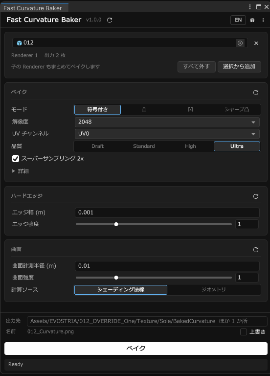

# Fast Curvature Baker User Guide

**Fast Curvature Baker** is a GPU-accelerated curvature map baker for the Unity Editor.  
Generate edge wear masks, crevice dirt/shadow masks, smooth curvature gradients, and corner-only masks for hard-surface models with a single click.

---

## UI Overview

From top to bottom, the window consists of:

1. **Top bar** — tool name, version, language, manual, menu
2. **Target card** — the GameObjects to bake
3. **Bake card** — mode, resolution and other basics, plus "Advanced"
4. **Hard Edges card** (becomes the "Sharp Convex / Narrow Bevel" card in Sharp mode)
5. **Smooth Surfaces card** (hidden in Sharp mode)
6. **Output dock** — output folder, file name, overwrite
7. **Bake button** and **status bar**

When the window is made smaller, only the cards in the middle scroll. The top bar and the bottom area (output dock, Bake button, status bar) always stay visible.

---

## Getting Started

Open the window from the Unity top menu: **`dennokoworks` > `Fast Curvature Baker`**.

---

## Basic Workflow

1. Select the objects to bake in the Hierarchy, then open the window (or drag & drop them onto the target card)
2. Choose the **Mode** and **Resolution** in the Bake card
3. Adjust the hard edge / smooth surface settings if needed
4. Press **`Bake`**
5. When the status bar shows `Saved: <file name>`, you're done. The saved texture is highlighted in the Project window automatically

---

## Features & Settings

### 1. Top Bar

| Element | Description |
|---|---|
| **Tool name** | `Fast Curvature Baker`. Truncated when the window is narrow. |
| **Version** | The current version (e.g. `v1.1.0`). Updates are checked automatically on startup. • `Update available <version>`: A newer version has been released (bold green) • `Checking…`: Checking for updates • `Cannot fetch latest`: The check failed (e.g. network error) |
| **`↻` (Check for updates)** | Retries the version check. |
| **`EN` / `JA`** | Switches the UI language. The button shows the language it **switches to** (`JA` while English is shown). The choice is remembered. |
| **`?` (Manual)** | Opens this manual (PDF) in the current language. |
| **`⋮` (Menu)** | • **Reset settings to defaults…**: Resets every setting (with confirmation; the target list is kept) • **Check for updates**: Same as `↻` |

> The `⋮` menu items and the top bar tooltips are currently shown in Japanese regardless of the language setting.

---

### 2. Target Card

Specifies the GameObjects to bake (those with a `MeshRenderer` or `SkinnedMeshRenderer`). This card has no title.

- **Auto-fill**: Only while the list is empty, the GameObjects selected in the Hierarchy are added automatically. Once targets are set, changing the selection does not change the list.
- **Drag & drop**: Drag GameObjects from the Hierarchy over the card — it lights up blue — and drop to add them.
- **`Add Selected`**: Adds the GameObjects selected in the Hierarchy.
- **`Clear`**: Empties the list (shown only when there are targets).
- **List rows**: Each row's field lets you swap the GameObject. The **`×`** at the right removes that row.
- **Info line**: Shows how many `Renderer`s will actually be baked and how many textures will be written (one per sub-mesh).
- **Warning line**: If some meshes have Read/Write disabled, `Read/Write is disabled on N mesh(es)` is shown. **`Enable`** turns it on in the model import settings (hover the warning to see the mesh names). If you bake anyway, a confirmation dialog appears before the bake starts.

> If a GameObject has no Renderer of its own, all of its active child Renderers are baked.

---

### 3. Bake Card

| Setting | Description | Effect of Changing |
|---|---|---|
| **Mode** | The type of map to output. • **Signed** (`Default`): Signed curvature (flat = 0.5 gray, convex = white, concave = black) • **Convex**: Convex areas only, in white (edge wear, chipping, highlights) • **Concave**: Concave crevices only, in white (dust, dirt, shadow masks) • **Sharp** (`SharpConvex`): Only convex hard edges and sharp corners with narrow bevels, white at a set width (smooth curves and concave areas stay black). See "4-b. Sharp Convex / Narrow Bevel" | Switches between grayscale masks and a full signed curvature map. Each mode uses its own file name suffix, so baking several modes never overwrites the others. |
| **Resolution** | Output texture resolution (256 / 512 / 1024 / 2048 / 4096). Default 2048. | **▲ Increase**: Sharper detail, but more bake time and memory. **▼ Decrease**: Faster and smaller, but coarser. |
| **UV Channel** | The mesh UV channel to bake into (UV0 to UV7). Default UV0. | Normally `UV0`, the main texture UV. |
| **Quality** | Sample points per radius (Draft: 4 / Standard: 6 / High: 8 / Ultra: 12). Default Standard. | **▲ Increase**: Less noise and better accuracy, but slower. **▼ Decrease**: Good for quick test bakes while tuning. |
| **Supersample 2x** | Evaluates at 2x resolution and averages down (automatically skipped at 4096). Default ON. | **ON**: Greatly reduces jagged edges on UV seams and thin features (about 4x bake time). **OFF**: Shorter bake time. |

#### Advanced

Click **`▶ Advanced`** at the bottom of the card to open it. While it is closed, only the settings changed from their defaults are listed next to the title as small chips (e.g. `Blur 2`, `Dilation 8px`).

| Setting | Description | Effect of Changing |
|---|---|---|
| **Same Part Only** | Uses samples only from the same connected mesh part as the texel. Default ON. | **ON**: Prevents false curvature from separate overlapping parts (e.g. clothing over skin). **OFF**: Treats nearby separate parts as one shape, detecting the gaps between them. |
| **Normal Rejection** | Dot-product threshold for ignoring nearby surfaces facing away from the texel (back faces etc.), from -1 to 0.75, default -0.5. Their weight fades back in over the next +0.25. | **▲ Increase**: Strictly prevents leaking through thin sheets (too high weakens crevice detection). **▼ Decrease**: Makes sure the bottoms of deep crevices are detected. |
| **Blur Passes** | Number of 3x3 Gaussian blur passes after the bake (0 to 16, default 0). | **▲ Increase**: Smooths fine noise (edges get slightly softer). **▼ Decrease**: Keeps the original sharpness (0 = off). |
| **Dilation (px)** | How far results are extended outward from UV island borders (0 to 64 px, default 16). | **▲ Increase**: Prevents dark seams with mipmaps or at a distance. **▼ Decrease**: Prevents bleeding into neighboring islands when they are packed tightly. |

---

### 4. Hard Edges Card

Settings for split-normal hard edges (clear polygon creases). Shown in **Signed / Convex / Concave** modes.

| Setting | Description | Effect of Changing |
|---|---|---|
| **Edge Width (m)** | World-space width (meters) around a hard edge that is treated as curvature. Default 0.003. | **▲ Increase**: Wider wear bands along edges. **▼ Decrease**: Thin, crisp lines like hard metal corners. |
| **Edge Strength** | Multiplier for hard edge curvature (0 to 4, default 1.0). A 90-degree edge reaches full brightness at 1.0. | **▲ Increase**: Even shallow creases stand out. **▼ Decrease**: Weaker edges; 0 disables hard edge detection. |

---

### 4-b. Sharp Convex / Narrow Bevel (Sharp Mode)

When Mode is set to **Sharp** (`SharpConvex`), the Hard Edges card becomes "Sharp Convex / Narrow Bevel", and the Smooth Surfaces card is hidden because it is not used. Output files get the `_SharpConvex` suffix.

**What becomes white**

- Convex hard edges (split normals)
- Convex corners that bend sharply even with smooth shading
- Corners rounded by a narrow bevel (chamfer). Bevels made of several edges are treated as one corner, judged by their total bend angle.

**What stays black**

- Smooth curved surfaces (arms, faces, cloth bulges, etc.). Unlike `Convex`, no surface curvature is included at all.
- Concave corners and crevices
- Diagonals inside flat faces and shallow support edges next to real corners (false detections are suppressed)

**`Convex` vs. `Sharp`**: `Convex` picks up both convex edges and surface bulges, which suits overall wear. Use `Sharp` when you want corners only — edge highlights on hard-surface models, or paint chipping on the edges of weapons, accessories, and mechanical parts.

| Setting | Description | Effect of Changing |
|---|---|---|
| **Mask Width (m)** | World-space width (meters) painted white around each detected corner. Shares its value with Edge Width of the other modes (default 0.003). | **▲ Increase**: Thicker corner lines. **▼ Decrease**: Thinner, crisper lines. |
| **Edge Strength** | Brightness multiplier of the mask. | **▲ Increase**: Shallower corners also approach white. **▼ Decrease**: Darker overall; 0 outputs nothing. |
| **Min Corner Angle (°)** | Minimum convex angle included in the mask (5–150°, default 45°). For bevels, the total bend across the whole bevel is used. | **▲ Increase**: Keeps only sharp, near-right-angle corners and drops gentle bends and low-poly facet creases. **▼ Decrease**: Includes somewhat gentler corners. |
| **Max Bevel Width (m)** | Widest bevel still treated as a sharp corner (0–0.05 m, default 0.004 = 4 mm). Wider roundings are treated as curved surfaces and not masked (fades out near the limit). | **▲ Increase**: Captures wider bevels and fillets (too large may pick up thin cylinders). **▼ Decrease**: Narrows detection to tight bevels and hard edges; 0 detects single-edge creases only. |

> **Tip**: If corners are broken up or missing, first set Max Bevel Width slightly larger than your model's bevel width. If curved surfaces turn white, lower Max Bevel Width or raise Min Corner Angle.

---

### 5. Smooth Surfaces Card

Settings for curvature on smooth surfaces. Hidden in Sharp mode because it is not used.

| Setting | Description | Effect of Changing |
|---|---|---|
| **Radius (m)** | World-space radius (meters) of the sphere searched to estimate curvature. Default 0.01. | **▲ Increase**: Captures broad undulations with smooth gradients. **▼ Decrease**: Reacts to fine details and small bumps. |
| **Strength** | Multiplier for smooth surface curvature (0 to 4, default 1.0). A sphere whose radius equals `Radius` reaches full brightness at 1.0. | **▲ Increase**: Stronger contrast even on gentle curves. **▼ Decrease**: Softer, subtler gradients; 0 disables smooth surface detection. |
| **Source** | The normals used to compute curvature. • **Shading Normals** (`ShadingNormals`): Follows the vertex normals (smooth shading). Default • **Geometry**: Uses the actual polygon face normals (measures every facet crease) | **Shading Normals**: Smooth gradients that follow the shading, even on low-poly meshes. **Geometry**: For high-poly or hard-surface meshes where you want every facet picked up. |

---

### Resetting a Card (`↺`)

The **`↺`** at the right of each card title resets **only that card's settings** to defaults (no confirmation; undo with `Ctrl + Z`).

- Bake card: Mode, Resolution, UV Channel, Quality, Supersample and the four Advanced settings
- Hard Edges / Sharp card: Edge Width, Edge Strength, Min Corner Angle, Max Bevel Width
- Smooth Surfaces card: Radius, Strength, Source

To reset everything at once, use `⋮` → "Reset settings to defaults…" in the top bar.

> Every setting change can be undone with Unity's Undo (`Ctrl + Z` / `Ctrl + Y`).

---

### 6. Output Dock

Output settings, always visible at the bottom of the window.

- **Output**: The folder the textures will actually be saved to (read-only).
  - If the material has a base texture: `<base texture folder>/BakedCurvature/`
  - If not: `Assets/BakedCurvature/`
  - If the targets save to several folders, `… +N more` is shown. Hover to see all of them.
- **Name**: An example of the saved file name: `<renderer name><mode suffix>.png` (`_Curvature` / `_Convex` / `_Concave` / `_SharpConvex`). Renderers with several sub-meshes use `<renderer>_<material>` (one texture per sub-mesh).
- **Overwrite**:
  - **OFF (default)**: If a file with the same name exists, a space and a number are appended (e.g. `Body_Curvature 1.png`).
  - **ON**: Overwrites the existing file.

---

### 7. Bake Button & Status Bar

- **`Bake`**: Starts baking. It is disabled while there are no targets (or no Renderers found); hover it to see why.
  - While baking, the button reads `Baking…` and Unity's progress bar is shown. Press **Cancel** on the progress bar to stop.
- **Status bar** (bottom line):
  - `Ready`: Idle
  - `Baking… <step>` (blue): In progress, with a progress line along the bottom
  - `Saved: <file name> (seconds)` (green): Done. **Click it to highlight the saved texture in the Project window.** With several textures it reads `… +N more`
  - `Bake cancelled.` (orange): When cancelled
  - Errors (red): The error count or message. If some textures failed, the error list is also shown in a dialog

Completion, warning and error messages return to `Ready` after 3 seconds.

---

## Use Cases & Tips

1. **Avatar & Costume Edge Wear / Chipping**
   - Set Mode to `Convex` and `Edge Width` to a small value (`0.002` – `0.005`).
   - Assign the baked texture to rim light, roughness or decal mask inputs in shaders like lilToon or Poiyomi to simulate worn metal or leather edges.

2. **Crevice Dirt & Shadow Masks**
   - Set Mode to `Concave`.
   - Multiply the texture in your shader to shade fabric folds, seams and crevices where dust collects.

3. **Substance Painter / 3D Painting Workflows**
   - Set Mode to `Signed`.
   - Use the map directly as a curvature input for smart materials and generators in external texturing tools.

4. **Corner-Only Highlights / Paint Chipping on Hard-Surface Models**
   - Set Mode to `Sharp` and match `Max Bevel Width` to your model's bevels (e.g. `0.004` for 2–4 mm bevels).
   - Only the edges of weapons, accessories or mechanical parts turn white, giving an edge highlight or chipping mask without any surface shading.
