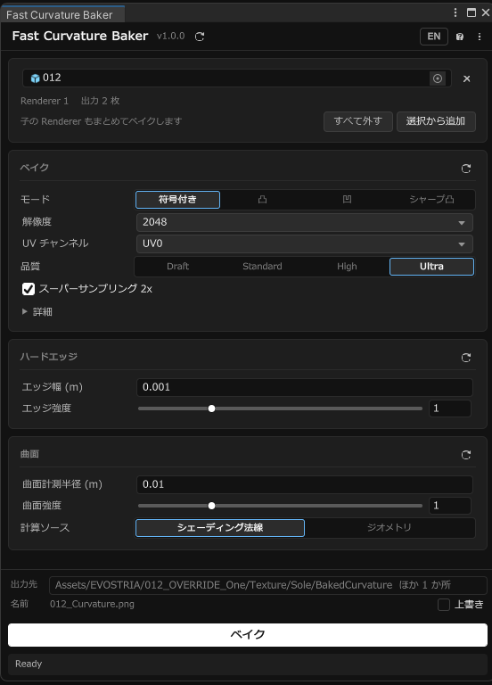

# Fast Curvature Baker 使い方ガイド

**Fast Curvature Baker** は、Unity エディタ上で 3D メッシュの曲率テクスチャ（Curvature Map）を GPU で高速に生成するツールです。  
エッジの摩耗表現、溝の汚れ・陰影マスク、なだらかな曲面の陰影、ハードサーフェスの角だけのマスクを、ワンクリックで作成できます。

---

## 画面構成

上から順に、次の部分でできています。

1. **トップバー** — ツール名・バージョン・言語切り替え・マニュアル・メニュー
2. **対象カード** — ベイクする GameObject
3. **ベイクカード** — モード・解像度などの基本設定と「詳細」
4. **ハードエッジカード**（シャープ凸モードでは「シャープ凸エッジ / 狭ベベル」カード）
5. **曲面カード**（シャープ凸モードでは非表示）
6. **出力ドック** — 出力先・ファイル名・上書き
7. **ベイクボタン** と **ステータスバー**

ウィンドウを縮めると、カードの並ぶ中央部分だけがスクロールします。トップバーと下部（出力ドック・ベイクボタン・ステータスバー）は常に表示されます。

---

## 起動方法

Unity 上部メニューの **`dennokoworks` > `Fast Curvature Baker`** を選択するとウィンドウが開きます。

---

## 基本の流れ

1. Hierarchy でベイクしたいオブジェクトを選んでからウィンドウを開く（または対象カードへドラッグ＆ドロップ）
2. ベイクカードで **モード** と **解像度** を選ぶ
3. 必要に応じてハードエッジ・曲面の設定を調整する
4. **`ベイク`** を押す
5. ステータスバーに `保存: <ファイル名>` と出たら完了。保存したテクスチャは Project ビューで自動的に選択表示されます

---

## 各部の解説

### 1. トップバー

| 要素 | 説明 |
|---|---|
| **ツール名** | `Fast Curvature Baker`。ウィンドウが狭いときは省略表示になります。 |
| **バージョン** | 現在のバージョン（例: `v1.1.0`）。起動時に最新版の有無を自動確認します。 ・`更新あり <最新版>`: 新しいバージョンが公開されています（緑の太字） ・`確認中…`: 確認しています ・`最新版を取得できません`: 通信エラーなどで確認できませんでした |
| **`↻`（更新を確認）** | 最新バージョンの確認をやり直します。 |
| **`EN` / `JA`** | 表示言語を切り替えます。ボタンには**切り替え先**の言語が表示されます（日本語表示中は `EN`）。設定は記憶されます。 |
| **`?`（マニュアル）** | このマニュアル（PDF）を開きます。表示中の言語のものが開きます。 |
| **`⋮`（メニュー）** | ・**設定を初期値に戻す…**: すべての設定を既定値に戻します（確認あり。対象の一覧はそのまま残ります） ・**更新を確認**: `↻` と同じです |

---

### 2. 対象カード

ベイクする GameObject（`MeshRenderer` または `SkinnedMeshRenderer` を持つもの）を指定します。カードに見出しはありません。

- **自動入力**: 対象が 1 つもないときだけ、Hierarchy で選んでいる GameObject が自動で入ります。対象が入っていれば、選択を変えても一覧は変わりません。
- **ドラッグ＆ドロップ**: Hierarchy から GameObject をカードの上へドラッグすると、カードが青く光り、離すと追加されます。
- **`選択から追加`**: Hierarchy で選んでいる GameObject を一覧に追加します。
- **`すべて外す`**: 一覧を空にします（対象があるときだけ表示）。
- **一覧の行**: 各行の欄で GameObject を差し替えられます。右端の **`×`** でその行だけを外せます。
- **情報行**: 実際にベイクされる `Renderer` の数と、出力されるテクスチャの枚数（サブメッシュ数）を表示します。
- **警告行**: Read/Write が無効なメッシュがあると `Read/Write が無効なメッシュがあります (件数)` と表示されます。**`有効にする`** を押すとモデルのインポート設定を変更して有効にします（警告にカーソルを合わせるとメッシュ名が出ます）。そのままベイクした場合も、開始前に確認ダイアログが出ます。

> GameObject 自身に Renderer がない場合は、その子の Renderer（有効なもの）をまとめてベイクします。

---

### 3. ベイクカード

| 設定項目 | 説明 | 増減・切替による変化 |
|---|---|---|
| **モード** `(Mode)` | 出力するテクスチャの種類を選びます。 ・**符号付き**（`Default`）: 符号付き曲率（平坦 = 0.5 のグレー、凸 = 白、凹 = 黒） ・**凸**（`Convex`）: 凸部だけを白で抽出（エッジの摩耗・剥げ・ハイライト用） ・**凹**（`Concave`）: 凹部・溝だけを白で抽出（埃・汚れ・陰影マスク用） ・**シャープ凸**（`SharpConvex`）: 凸のハードエッジと幅の狭いベベルの急な角だけを、指定した幅で白く抽出（緩やかな曲面・凹部は黒）。詳しくは「4-b. シャープ凸エッジ / 狭ベベル」 | 用途に応じた白黒マスクや全体の曲率マップを切り替えます。モードごとにファイル名の末尾が変わるので、並べてベイクしても上書きされません。 |
| **解像度** `(Resolution)` | 出力テクスチャの解像度（256 / 512 / 1024 / 2048 / 4096）。既定は 2048。 | **▲増やす**: 細部が鮮明になりますが、ベイク時間とメモリが増えます。 **▼減らす**: 速く・軽くなりますが、粗くなります。 |
| **UV チャンネル** `(UV Channel)` | ベイクに使うメッシュの UV（UV0 〜 UV7）。既定は UV0。 | 通常はメインテクスチャ用の `UV0` を使います。 |
| **品質** `(Quality)` | 半径あたりのサンプリング点数（Draft: 4 / Standard: 6 / High: 8 / Ultra: 12）。既定は Standard。 | **▲上げる**: ノイズが減り精度が上がりますが、時間が増えます。 **▼下げる**: 調整中の試しベイクに向きます。 |
| **スーパーサンプリング 2x** `(Supersample 2x)` | 内部で 2 倍の解像度で計算し、平均して出力します（解像度 4096 のときは自動で無効）。既定は ON。 | **ON**: UV 境界や細い部分のジャギーを大きく減らします（時間は約 4 倍）。 **OFF**: ベイク時間を短縮します。 |

#### 詳細

カード下部の **`▶ 詳細`** をクリックすると開きます。閉じている間は、既定値から変えた項目だけが見出しの横に小さなチップ（例: `ブラー 2`、`拡張 8px`）で表示されます。

| 設定項目 | 説明 | 切替・増減による変化 |
|---|---|---|
| **同一接続パーツのみ** `(Same Part Only)` | テクセルと同じ、つながったメッシュパーツ（連結成分）だけからサンプルを取ります。既定は ON。 | **ON**: 肌の上に重なった服のような、別パーツからの不要な曲率の映り込みを防ぎます。 **OFF**: 近接する別パーツ同士の隙間も、一体の形として凹凸を検出します。 |
| **法線拒絶しきい値** `(Normal Rejection)` | テクセルの法線と逆向き（裏面など）の近接面を除外する内積のしきい値（-1 〜 0.75、既定 -0.5）。そこから +0.25 の範囲で重みが徐々に戻ります。 | **▲増やす**: 薄い板の裏表などの干渉を厳しく防ぎます（上げすぎると溝の検出が弱まります）。 **▼減らす**: 深い溝の谷底でも確実に検出します。 |
| **ブラー反復回数** `(Blur Passes)` | ベイク後に掛ける 3x3 ガウシアンブラーの回数（0 〜 16、既定 0）。 | **▲増やす**: 細かなノイズを滑らかにします（エッジはやや甘くなります）。 **▼減らす**: 元のシャープな結果を保ちます（0 で無効）。 |
| **ピクセル拡張幅 (px)** `(Dilation)` | UV アイランドの境界から外側へ結果を引き伸ばす幅（0 〜 64px、既定 16）。 | **▲増やす**: ミップマップや遠景で出る黒い継ぎ目（シーム）を防ぎます。 **▼減らす**: UV アイランドの間が狭いときに、隣の島へのにじみを防ぎます。 |

---

### 4. ハードエッジカード

法線が分割されている角（ハードエッジ・ポリゴンの明確な折り目）の設定です。モードが **符号付き / 凸 / 凹** のときに表示されます。

| 設定項目 | 説明 | 増減による変化 |
|---|---|---|
| **エッジ幅 (m)** `(Edge Width)` | ハードエッジから曲率として扱うワールド空間の幅（メートル）。既定 0.003。 | **▲増やす**: 角の摩耗線が太く広がります。 **▼減らす**: 金属の硬い角のような、細くシャープなラインになります。 |
| **エッジ強度** `(Edge Strength)` | ハードエッジの曲率の倍率（0 〜 4、既定 1.0）。1.0 で 90 度の直角が最大の明るさになります。 | **▲増やす**: 浅い折り目もはっきり出ます。 **▼減らす**: 影響が弱まり、0 でハードエッジの検出が無効になります。 |

---

### 4-b. シャープ凸エッジ / 狭ベベル（シャープ凸モード）

モードを **シャープ凸**（`SharpConvex`）にすると、ハードエッジカードが「シャープ凸エッジ / 狭ベベル」に切り替わり、曲面カードは使わないため非表示になります。出力ファイル名の末尾は `_SharpConvex` です。

**白くなるもの**

- 法線が分割された凸のハードエッジ
- スムースシェーディングでも急に折れている凸の角
- 幅の狭いベベル（面取り）で丸められた角。1 本のエッジだけでなく、数本のエッジに分かれたベベルも、その合計の曲がり角度で 1 つの角として扱います。

**白くならないもの**

- 緩やかな曲面（腕・顔・布のふくらみなど）。`凸` モードと違い、曲面の陰影は一切入りません。
- 凹んだ角・溝
- 平らな面の中の対角線や、本物の角の近くにある浅い補助エッジ（誤検出を抑える処理が入っています）

**`凸` との使い分け**: `凸` は凸のエッジと曲面のふくらみの両方を拾うので、全体の摩耗表現に向きます。`シャープ凸` は「角だけ」が欲しいとき（ハードサーフェスの縁のハイライト、武器・アクセサリー・メカパーツの角の塗装剥げなど）に使います。

| 設定項目 | 説明 | 増減による変化 |
|---|---|---|
| **マスク幅 (m)** `(Mask Width)` | 検出した角から白く塗るワールド空間の幅（メートル）。他のモードの「エッジ幅」と同じ値を共有します（既定 0.003）。 | **▲増やす**: 角のラインが太くなります。 **▼減らす**: 細くシャープなラインになります。 |
| **エッジ強度** `(Edge Strength)` | マスクの明るさの倍率です。 | **▲増やす**: 浅めの角も白に近づきます。 **▼減らす**: 全体が暗くなり、0 で何も出力されません。 |
| **最小角角度 (°)** `(Min Corner Angle)` | マスクする凸角の最小角度（5 〜 150°、既定 45°）。ベベルの場合は、ベベル全体で曲がる角度の合計で判定します。 | **▲増やす**: 直角に近い鋭い角だけに絞り、緩い折れやローポリ曲面の折れ目を除外します。 **▼減らす**: やや緩やかな角もマスクに含めます。 |
| **最大ベベル幅 (m)** `(Max Bevel Width)` | 「急な角」とみなすベベルの最大幅（0 〜 0.05m、既定 0.004 = 4mm）。これより広い丸みは曲面として扱い、マスクしません（上限付近では徐々に弱まります）。 | **▲増やす**: 幅の広いベベルや丸角も角として拾います（大きすぎると細い円柱なども拾います）。 **▼減らす**: 細いベベルとハードエッジだけに絞ります。0 にすると 1 本のエッジの折れだけを検出します。 |

> **ヒント**: 角が途切れる・拾われない場合は、まず「最大ベベル幅」をモデルのベベル幅より少し大きくしてみてください。曲面まで白くなる場合は「最大ベベル幅」を下げるか「最小角角度」を上げます。

---

### 5. 曲面カード

なだらかな面（スムース面）の曲率の設定です。シャープ凸モードでは使わないため非表示になります。

| 設定項目 | 説明 | 増減・切替による変化 |
|---|---|---|
| **曲面計測半径 (m)** `(Radius)` | 曲率を計算するために周囲を探索する球の半径（メートル）。既定 0.01。 | **▲増やす**: 大きなうねりや緩やかな曲面を捉え、滑らかなグラデーションになります。 **▼減らす**: 細かなモールドや小さな凹凸に敏感に反応します。 |
| **曲面強度** `(Strength)` | スムース面の曲率の倍率（0 〜 4、既定 1.0）。半径が `曲面計測半径` と同じ球面が 1.0 で最大の明るさになります。 | **▲増やす**: なだらかな曲面でも白黒のメリハリが強くなります。 **▼減らす**: 淡く柔らかい階調になります。0 で曲面の検出が無効になります。 |
| **計算ソース** `(Source)` | 曲率の計算に使う法線を選びます。 ・**シェーディング法線**（`ShadingNormals`）: 頂点法線（滑らかな陰影）に従う。既定 ・**ジオメトリ**（`Geometry`）: 実際のポリゴンの面法線（面の折り目を直接計測） | **シェーディング法線**: ローポリでも陰影どおりの滑らかなグラデーションになります。 **ジオメトリ**: ハイポリやハードサーフェスで、ポリゴンの折れを全部拾いたいときに向きます。 |

---

### カードの初期値リセット（`↺`）

各カードの見出し右端にある **`↺`** を押すと、**そのカードの設定だけ**が既定値に戻ります（確認なし。`Ctrl + Z` で戻せます）。

- ベイクカード: モード・解像度・UV チャンネル・品質・スーパーサンプリングと「詳細」の 4 項目
- ハードエッジ / シャープ凸カード: エッジ幅・エッジ強度・最小角角度・最大ベベル幅
- 曲面カード: 曲面計測半径・曲面強度・計算ソース

全部まとめて戻すときは、トップバーの `⋮` →「設定を初期値に戻す…」を使います。

> 設定の変更はすべて Unity の Undo（`Ctrl + Z` / `Ctrl + Y`）で戻せます。

---

### 6. 出力ドック

ウィンドウ下部に常に表示される、出力の設定です。

- **出力先**: 実際に保存されるフォルダを表示します（編集はできません）。
  - マテリアルにベーステクスチャがある場合: `<ベーステクスチャのフォルダ>/BakedCurvature/`
  - テクスチャがない場合: `Assets/BakedCurvature/`
  - 対象によって保存先が複数になる場合は `… ほか N か所` と表示されます。カーソルを合わせると全部の保存先が出ます。
- **名前**: 保存されるファイル名の例です。`<Renderer 名><モードごとの末尾>.png`（`_Curvature` / `_Convex` / `_Concave` / `_SharpConvex`）。サブメッシュが複数ある Renderer は `<Renderer 名>_<マテリアル名>` になります（サブメッシュごとに 1 枚ずつ出力されます）。
- **上書き**:
  - **OFF（既定）**: 同名のファイルがあると、末尾に `スペース + 連番` を付けて別名で保存します（例: `Body_Curvature 1.png`）。
  - **ON**: 既存のファイルを上書きします。

---

### 7. ベイクボタンとステータスバー

- **`ベイク`**: ベイクを開始します。対象がない（または Renderer が見つからない）間は押せず、カーソルを合わせると理由が表示されます。
  - 実行中はボタンが `ベイク中…` になり、Unity のプログレスバーが表示されます。プログレスバーの **Cancel** で中断できます。
- **ステータスバー**（最下段）:
  - `Ready`: 待機中
  - `ベイク中… <処理内容>`（青）: 処理中。下端に進捗の線が伸びます
  - `保存: <ファイル名> (秒数)`（緑）: 完了。**クリックすると保存したテクスチャを Project ビューで選択表示します**。複数枚のときは `… ほか N 枚` と表示されます
  - `ベイクを中断しました。`（橙）: キャンセルしたとき
  - エラー（赤）: エラーの件数や内容。一部のテクスチャでエラーが出たときは、エラーの一覧がダイアログでも表示されます

完了・警告・エラーの表示は 3 秒後に `Ready` に戻ります。

---

## 主な活用例

1. **アバターや衣装のエッジ摩耗・傷表現**
   - モードを `凸` にし、`エッジ幅` を小さめ（`0.002` 〜 `0.005`）にしてベイク。
   - 出力したテクスチャを lilToon や Poiyomi のリムライト・ラフネスマスク・デカールマスクなどに割り当てると、金属や革の角が擦れた表現になります。

2. **溝やシワの汚れ・陰影マスク**
   - モードを `凹` にしてベイク。
   - 服のシワの谷間やパーツの継ぎ目に溜まる埃・陰影として、シェーダーで乗算合成できます。

3. **Substance Painter や 3D ペイントソフトへの持ち込み**
   - モードを `符号付き` にしてベイク。
   - 他のツールのスマートマテリアルやジェネレーター用の曲率マップとして、そのまま使えます。

4. **ハードサーフェスの角だけのハイライト・塗装剥げ**
   - モードを `シャープ凸` にし、`最大ベベル幅` をモデルのベベル幅（例: 2 〜 4mm なら `0.004`）に合わせてベイク。
   - 武器・アクセサリー・メカパーツの縁だけが白くなるので、曲面の陰影を拾わずにエッジハイライトや塗装剥げのマスクとして使えます。
